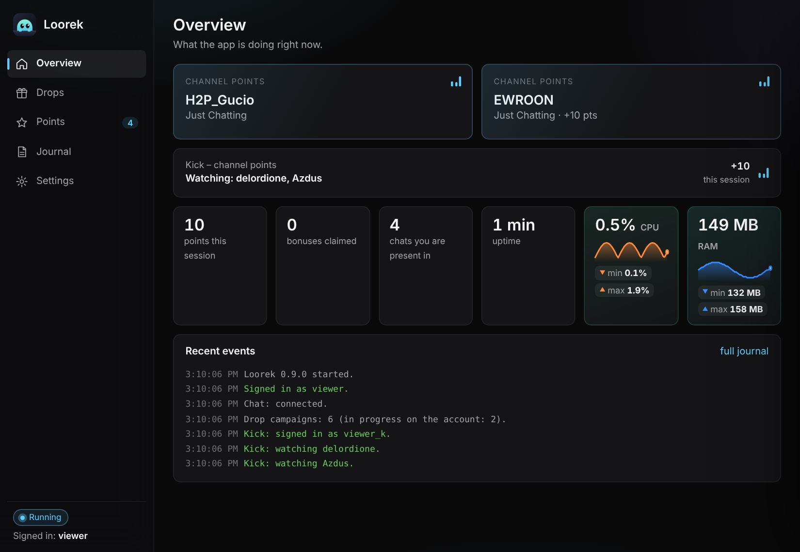
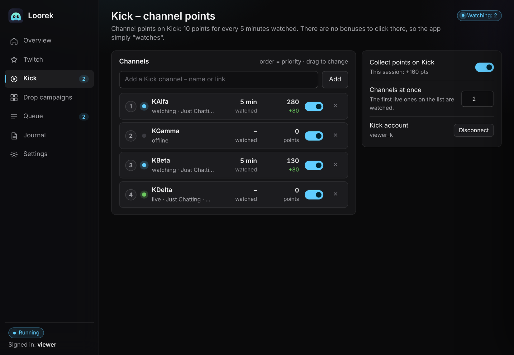

<p align="center"></p>
<h1 align="center">Loorek – Twitch &amp; Kick Points and Drops Collector</h1>
<p align="center">A small Windows tray app that collects <b>Twitch and Kick channel points</b> and farms <b>Twitch Drops</b> in the background.<br>No browser tab, no video playback.</p>
<p align="center">
  <a href="https://github.com/Yasaiek/Loorek-Twitch-Kick-Points-Drops/releases/latest/download/Loorek.exe"><b>Download Loorek.exe</b></a> ·
  <a href="https://yasaiek.github.io/Loorek-Twitch-Kick-Points-Drops/">Website</a> ·
  <a href="CHANGELOG.md">Changelog</a>
</p>



> **Beta.** Loorek is young and has been tested on a small number of setups. Expect rough edges and please open an issue when something does not work.

## What it does

- **Twitch channel points** – watches up to two channels at a time (that is all Twitch credits) and claims every bonus on its own.
- **Chat presence** – stays in the chats of all the channels on your list.
- **Twitch Drops** – queue games, see every campaign and reward, and let Loorek pick a stream, switch when it ends or stalls, and claim the drop. Tracked games start by themselves when a new campaign appears.
- **Kick channel points** – collects points on the Kick channels you choose.
- **Runs in the tray** – close the panel and everything keeps going. Optional start with Windows.
- **Light** – it does not decode video; it only reports to the service that you are watching.
- **Keeps to itself** – an ordinary desktop program that never touches other processes.
- **Updates itself** from the releases of this repository (SHA-256 checked).
- **12 languages** – English, Polski, Deutsch, Français, Español, Italiano, Português (BR), Русский, Українська, Türkçe, 日本語, 简体中文.

| Drops queue | Kick |
| --- | --- |
|  |  |

## Getting started

1. Download **Loorek.exe** and run it. There is no installer; the icon appears in the tray next to the clock and the panel opens.
2. Click **Sign in**. A separate sign-in window opens with Twitch – sign in as usual and the window closes by itself. The same goes for Kick on its tab.
3. Add channels under **Points** (order = priority; start typing and pick the channel from the suggestions) and pick games under **Drops → Drop campaigns**. Under **Drops → Tracked games** you can search for any game and have it farmed as soon as a campaign appears.

Windows may warn about an unknown publisher, because the file is not code-signed. Every release is built from this source by [GitHub Actions](.github/workflows/release.yml).

## Where your data lives

Everything Loorek stores is in the `data` folder next to `Loorek.exe`:

| File | What it is |
| --- | --- |
| `settings.json` | settings, channel lists, queue |
| `auth.json` | your Twitch and Kick sessions – never share this file |
| `login-profile/` | the profile of the sign-in window – never share it either |
| `log.txt` | the journal |

Sessions are sent only to Twitch and Kick themselves. The sign-in window is the Edge/Chrome already installed on your computer, started with its own separate profile; Loorek does not read your everyday browser profile. Signing out in the app deletes that profile.

Loorek talks to: Twitch, Kick, and GitHub (update check). Nothing else.

## Build from source

Go 1.24 or newer:

```
GOOS=windows GOARCH=amd64 CGO_ENABLED=0 go build -trimpath -ldflags "-H=windowsgui -s -w" -o Loorek.exe .
```

The panel is plain HTML in [`ui/`](ui), translations are JSON files in [`ui/lang/`](ui/lang). `mock/` is a small stand-in for Twitch and Kick used for testing.

## Credits

Protocol knowledge comes from these projects – thank you:

- [TwitchDropsMiner](https://github.com/DevilXD/TwitchDropsMiner) by DevilXD (MIT)
- [Kick_Channel_Points_Miner](https://github.com/Baillora/Kick_Channel_Points_Miner) by Baillora (MIT)

Libraries: [fyne.io/systray](https://github.com/fyne-io/systray), [bogdanfinn/tls-client](https://github.com/bogdanfinn/tls-client).

Looking for a browser extension instead? See [Dropomat](https://github.com/Yasaiek/Dropomat-Auto-Twitch-Drops).

## Disclaimer

Automated watching is against the terms of service of Twitch and Kick. Loorek is not affiliated with either of them. You use it at your own risk.

<sub>MIT licence</sub>
