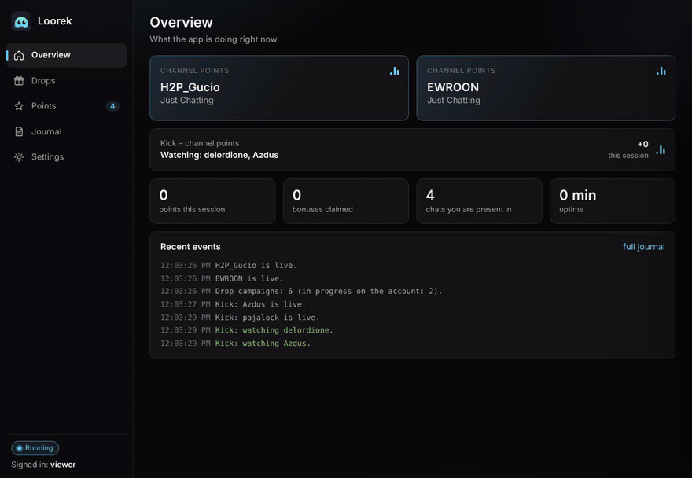
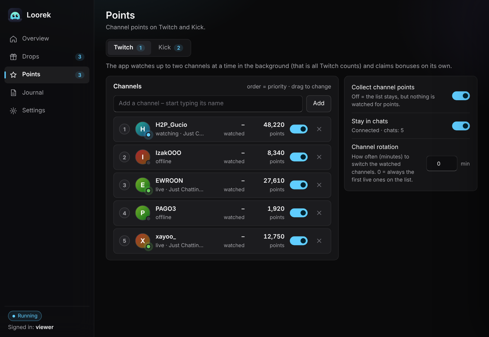

<p align="center"></p>
<h1 align="center">Loorek – Twitch &amp; Kick Points and Drops Collector</h1>
<p align="center">Una pequeña aplicación de Windows en la bandeja que recoge <b>puntos de canal de Twitch y Kick</b> y consigue <b>Twitch Drops</b> en segundo plano.<br>Sin pestaña del navegador, sin reproducir vídeo.</p>
<p align="center"><a href="../../README.md" title="English"></a> <a href="README.pl.md" title="Polski"></a> <a href="README.de.md" title="Deutsch"></a> <a href="README.fr.md" title="Français"></a> <a href="README.es.md" title="Español"></a> <a href="README.pt.md" title="Português (BR)"></a> <a href="README.it.md" title="Italiano"></a> <a href="README.ru.md" title="Русский"></a> <a href="README.uk.md" title="Українська"></a> <a href="README.tr.md" title="Türkçe"></a> <a href="README.ja.md" title="日本語"></a> <a href="README.zh.md" title="简体中文"></a></p>
<p align="center">
  <a href="https://github.com/Yasaiek/Loorek-Twitch-Kick-Points-Drops/releases/latest/download/Loorek.exe"><b>⬇ Descargar Loorek.exe</b></a> &nbsp;·&nbsp;
  <a href="https://yasaiek.github.io/Loorek-Twitch-Kick-Points-Drops/"><b>🌐 Sitio web</b></a> &nbsp;·&nbsp;
  <a href="../../CHANGELOG.md">Cambios</a> &nbsp;·&nbsp;
  <a href="https://github.com/Yasaiek/Loorek-Twitch-Kick-Points-Drops/issues/new">Informar de un error</a>
</p>
<p align="center"></p>

> **Beta.** Loorek es joven y se ha probado en pocos equipos. Puede tener fallos; abre una issue si algo no funciona.

## Qué hace

- **Puntos de canal de Twitch** – ve hasta dos canales a la vez (es lo que Twitch cuenta) y reclama cada bonus por sí solo.
- **Presencia en el chat** – permanece en los chats de todos los canales de tu lista.
- **Twitch Drops** – pon juegos en cola, mira cada campaña y recompensa; Loorek elige un directo, cambia cuando termina o se atasca y reclama el drop.
- **Juegos seguidos** – busca cualquier juego y síguelo; empieza solo cuando aparece una campaña.
- **Puntos de canal de Kick** – recoge puntos en los canales de Kick que elijas.
- **Fácil de configurar** – sugerencias de canales con avatares mientras escribes.
- **Funciona en la bandeja** – cierra el panel y todo sigue. No decodifica vídeo ni toca otros procesos.
- **Se actualiza solo** desde las releases de este repositorio (SHA-256 comprobado).
- **12 idiomas**, cambiables en cualquier momento.

| Campañas de drops | Cola |
| --- | --- |
|  |  |
| **Puntos de Twitch** | **Puntos de Kick** |
|  |  |

## Primeros pasos

1. Descarga **Loorek.exe** y ejecútalo. No hay instalador; el icono aparece junto al reloj y se abre el panel.
2. Haz clic en **Iniciar sesión**. Se abre una ventana aparte de Twitch – inicia sesión como siempre y se cerrará sola. Kick funciona igual.
3. Añade canales en **Puntos** y elige juegos en **Drops**. El orden es la prioridad.

Windows puede avisar de un editor desconocido porque el archivo no está firmado. Cada release la compila GitHub Actions a partir de este código.

## Dónde están tus datos

Todo lo que Loorek guarda está en la carpeta `data` junto a `Loorek.exe`:

| Archivo | Qué es |
| --- | --- |
| `settings.json` | ajustes, listas de canales, cola |
| `auth.json` | tus sesiones de Twitch y Kick – nunca compartas este archivo |
| `login-profile/` | el perfil de la ventana de inicio de sesión – tampoco lo compartas |
| `log.txt` | el diario |

Las sesiones solo se envían a Twitch y Kick. La ventana de inicio de sesión es el Edge/Chrome ya instalado, abierto con un perfil aparte; Loorek no lee tu perfil habitual del navegador.

Loorek se comunica con: Twitch, Kick y GitHub (comprobación de actualizaciones). Nada más.

## Compilar desde el código

Go 1.24 o posterior:

```
GOOS=windows GOARCH=amd64 CGO_ENABLED=0 go build -trimpath -ldflags "-H=windowsgui -s -w" -o Loorek.exe .
```

El panel es HTML sencillo en `ui/`, las traducciones son archivos JSON en `ui/lang/`.

## Créditos

El conocimiento de los protocolos viene de estos proyectos – gracias:

- [TwitchDropsMiner](https://github.com/DevilXD/TwitchDropsMiner) – DevilXD (MIT)
- [Kick_Channel_Points_Miner](https://github.com/Baillora/Kick_Channel_Points_Miner) – Baillora (MIT)
- [fyne.io/systray](https://github.com/fyne-io/systray), [bogdanfinn/tls-client](https://github.com/bogdanfinn/tls-client)

¿Prefieres una extensión de navegador? Mira [Dropomat](https://github.com/Yasaiek/Dropomat-Auto-Twitch-Drops).

## Aviso

Ver de forma automatizada va contra las condiciones de servicio de Twitch y Kick. Loorek no está afiliado a ninguno de los dos. Lo usas bajo tu propia responsabilidad.

<sub>MIT</sub>
