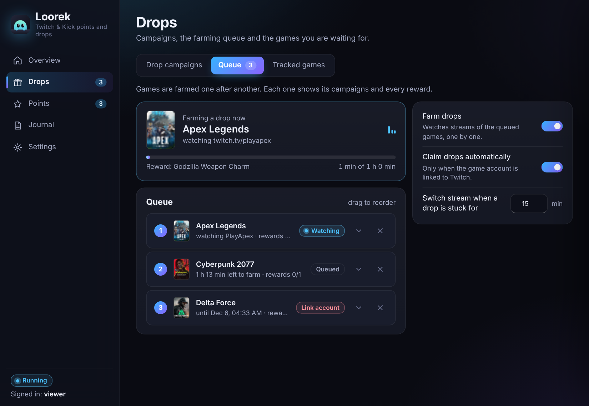

<p align="center"></p>
<h1 align="center">Loorek – Twitch &amp; Kick Points and Drops Collector</h1>
<p align="center">タスクトレイに常駐する小さな Windows アプリ。バックグラウンドで <b>Twitch と Kick のチャンネルポイント</b>を集め、<b>Twitch Drops</b> を獲得します。<br>ブラウザーのタブも動画再生も不要です。</p>
<p align="center"><a href="../../README.md" title="English"></a> <a href="README.pl.md" title="Polski"></a> <a href="README.de.md" title="Deutsch"></a> <a href="README.fr.md" title="Français"></a> <a href="README.es.md" title="Español"></a> <a href="README.pt.md" title="Português (BR)"></a> <a href="README.it.md" title="Italiano"></a> <a href="README.ru.md" title="Русский"></a> <a href="README.uk.md" title="Українська"></a> <a href="README.tr.md" title="Türkçe"></a> <a href="README.ja.md" title="日本語"></a> <a href="README.zh.md" title="简体中文"></a></p>
<p align="center">
  <a href="https://github.com/Yasaiek/Loorek-Twitch-Kick-Points-Drops/releases/latest/download/Loorek.exe"><b>⬇ Loorek.exe をダウンロード</b></a> &nbsp;·&nbsp;
  <a href="https://yasaiek.github.io/Loorek-Twitch-Kick-Points-Drops/"><b>🌐 ウェブサイト</b></a> &nbsp;·&nbsp;
  <a href="../../CHANGELOG.md">更新履歴</a> &nbsp;·&nbsp;
  <a href="https://github.com/Yasaiek/Loorek-Twitch-Kick-Points-Drops/issues/new">不具合を報告</a>
</p>
<p align="center"></p>

> **Beta.** Loorek はまだ新しく、少数の環境でしかテストされていません。うまく動かないときは issue を作成してください。

## できること

- **Twitch チャンネルポイント** – 同時に最大 2 チャンネルを視聴し（Twitch が数えるのはそこまで）、ボーナスを自動で受け取ります。
- **チャットに参加** – リストにあるすべてのチャンネルのチャットに留まります。
- **Twitch Drops** – ゲームを順番に並べ、各キャンペーンと報酬を確認。配信の選択、終了や停滞時の切り替え、ドロップの受け取りは Loorek が行います。
- **追跡中のゲーム** – 好きなゲームを検索して追跡。キャンペーンが始まると自動で開始します。
- **Kick チャンネルポイント** – 選んだ Kick チャンネルでポイントを集めます。
- **簡単な設定** – 入力中にアバター付きのチャンネル候補を表示。
- **タスクトレイで動作** – パネルを閉じても動き続けます。動画をデコードせず、他のプロセスにも触れません。
- **自動更新** – このリポジトリのリリースから（SHA-256 を検証）。
- **12 言語**、いつでも切り替え可能。

| ドロップキャンペーン | 順番待ち |
| --- | --- |
|  |  |
| **Twitch ポイント** | **Kick ポイント** |
|  |  |

## はじめに

1. **Loorek.exe** をダウンロードして実行します。インストーラーはありません。時計の横にアイコンが現れ、パネルが開きます。
2. **ログイン**をクリックします。Twitch 用の別ウィンドウが開くので、いつも通りログインすると自動で閉じます。Kick も同じです。
3. **ポイント**でチャンネルを追加し、**ドロップ**でゲームを選びます。並び順が優先順位です。

ファイルに署名がないため、Windows が発行元不明の警告を出すことがあります。各リリースは GitHub Actions がこのソースからビルドしています。

## データの保存場所

Loorek が保存するものはすべて `%LOCALAPPDATA%\Yasaiek\Loorek` にあります（設定 → データフォルダーで別の場所を選べます）。

| ファイル | 内容 |
| --- | --- |
| `loorek-settings.json` | 設定、チャンネルリスト、順番待ち |
| `auth.json` | Twitch と Kick のセッション – このファイルは絶対に共有しないでください |
| `login-profile/` | ログイン用ウィンドウのプロファイル – これも共有しないでください |
| `log.txt` | ログ |

セッションは Twitch と Kick 自体にのみ送信されます。ログイン用ウィンドウは PC にインストール済みの Edge/Chrome を別プロファイルで起動したもので、Loorek は普段のブラウザープロファイルを読みません。

Loorek の通信先：Twitch、Kick、GitHub（更新確認）。それ以外はありません。

## ソースからビルド

Go 1.24 以降：

```
GOOS=windows GOARCH=amd64 CGO_ENABLED=0 go build -trimpath -ldflags "-H=windowsgui -s -w" -o Loorek.exe .
```

パネルは `ui/` 内のプレーンな HTML、翻訳は `ui/lang/` 内の JSON ファイルです。

## 謝辞

プロトコルの知識は次のプロジェクトに基づいています。ありがとうございます。

- [TwitchDropsMiner](https://github.com/DevilXD/TwitchDropsMiner) – DevilXD (MIT)
- [Kick_Channel_Points_Miner](https://github.com/Baillora/Kick_Channel_Points_Miner) – Baillora (MIT)
- [fyne.io/systray](https://github.com/fyne-io/systray), [bogdanfinn/tls-client](https://github.com/bogdanfinn/tls-client)

ブラウザー拡張機能をお探しですか？こちら： [Dropomat](https://github.com/Yasaiek/Dropomat-Auto-Twitch-Drops).

## 免責事項

自動視聴は Twitch と Kick の利用規約に違反します。Loorek はどちらとも提携していません。自己責任でご利用ください。

<sub>MIT</sub>
