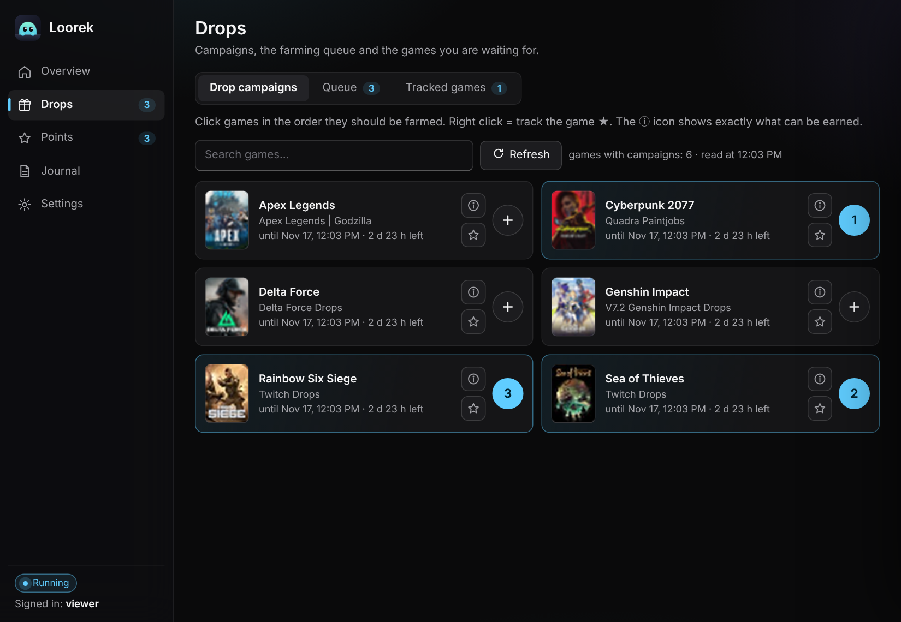

<p align="center"></p>
<h1 align="center">Loorek – Twitch &amp; Kick Points and Drops Collector</h1>
<p align="center">Um pequeno aplicativo para Windows que fica na bandeja, coleta <b>pontos de canal da Twitch e do Kick</b> e consegue <b>Twitch Drops</b> em segundo plano.<br>Sem aba do navegador, sem reproduzir vídeo.</p>
<p align="center"><a href="../../README.md" title="English"></a> <a href="README.pl.md" title="Polski"></a> <a href="README.de.md" title="Deutsch"></a> <a href="README.fr.md" title="Français"></a> <a href="README.es.md" title="Español"></a> <a href="README.pt.md" title="Português (BR)"></a> <a href="README.it.md" title="Italiano"></a> <a href="README.ru.md" title="Русский"></a> <a href="README.uk.md" title="Українська"></a> <a href="README.tr.md" title="Türkçe"></a> <a href="README.ja.md" title="日本語"></a> <a href="README.zh.md" title="简体中文"></a></p>
<p align="center">
  <a href="https://github.com/Yasaiek/Loorek-Twitch-Kick-Points-Drops/releases/latest/download/Loorek.exe"><b>⬇ Baixar Loorek.exe</b></a> &nbsp;·&nbsp;
  <a href="https://yasaiek.github.io/Loorek-Twitch-Kick-Points-Drops/"><b>🌐 Site</b></a> &nbsp;·&nbsp;
  <a href="../../CHANGELOG.md">Alterações</a> &nbsp;·&nbsp;
  <a href="https://github.com/Yasaiek/Loorek-Twitch-Kick-Points-Drops/issues/new">Relatar um bug</a>
</p>
<p align="center"></p>

> **Beta.** O Loorek é novo e foi testado em poucos computadores. Pode haver falhas; abra uma issue se algo não funcionar.

## O que ele faz

- **Pontos de canal da Twitch** – assiste até dois canais ao mesmo tempo (é o que a Twitch conta) e resgata cada bônus sozinho.
- **Presença no chat** – fica nos chats de todos os canais da sua lista.
- **Twitch Drops** – coloque jogos na fila, veja cada campanha e recompensa; o Loorek escolhe a live, troca quando ela acaba ou trava e resgata o drop.
- **Jogos acompanhados** – procure qualquer jogo e acompanhe; começa sozinho quando surge uma campanha.
- **Pontos de canal do Kick** – coleta pontos nos canais do Kick que você escolher.
- **Fácil de configurar** – sugestões de canais com avatares enquanto você digita.
- **Roda na bandeja** – feche o painel e tudo continua. Não decodifica vídeo nem mexe em outros processos.
- **Atualiza sozinho** a partir das releases deste repositório (SHA-256 verificado).
- **12 idiomas**, que podem ser trocados a qualquer momento.

| Campanhas de drops | Fila |
| --- | --- |
|  |  |
| **Pontos da Twitch** | **Pontos do Kick** |
|  |  |

## Primeiros passos

1. Baixe o **Loorek.exe** e execute. Não há instalador; o ícone aparece ao lado do relógio e o painel abre.
2. Clique em **Entrar**. Abre-se uma janela separada da Twitch – entre como de costume e ela fecha sozinha. No Kick é igual.
3. Adicione canais em **Pontos** e escolha jogos em **Drops**. A ordem é a prioridade.

O Windows pode avisar sobre editor desconhecido, pois o arquivo não é assinado. Cada release é compilada a partir deste código pelo GitHub Actions.

## Onde ficam seus dados

Tudo o que o Loorek guarda fica na pasta `data` ao lado do `Loorek.exe`:

| Arquivo | O que é |
| --- | --- |
| `settings.json` | configurações, listas de canais, fila |
| `auth.json` | suas sessões da Twitch e do Kick – nunca compartilhe este arquivo |
| `login-profile/` | o perfil da janela de login – também não compartilhe |
| `log.txt` | o diário |

As sessões são enviadas apenas à Twitch e ao Kick. A janela de login é o Edge/Chrome já instalado, aberto com um perfil separado; o Loorek não lê o seu perfil habitual do navegador.

O Loorek se comunica com: Twitch, Kick e GitHub (verificação de atualização). Nada mais.

## Compilar a partir do código

Go 1.24 ou mais recente:

```
GOOS=windows GOARCH=amd64 CGO_ENABLED=0 go build -trimpath -ldflags "-H=windowsgui -s -w" -o Loorek.exe .
```

O painel é HTML simples em `ui/`, as traduções são arquivos JSON em `ui/lang/`.

## Créditos

O conhecimento dos protocolos vem destes projetos – obrigado:

- [TwitchDropsMiner](https://github.com/DevilXD/TwitchDropsMiner) – DevilXD (MIT)
- [Kick_Channel_Points_Miner](https://github.com/Baillora/Kick_Channel_Points_Miner) – Baillora (MIT)
- [fyne.io/systray](https://github.com/fyne-io/systray), [bogdanfinn/tls-client](https://github.com/bogdanfinn/tls-client)

Prefere uma extensão de navegador? Veja [Dropomat](https://github.com/Yasaiek/Dropomat-Auto-Twitch-Drops).

## Aviso

Assistir de forma automatizada é contra os termos de serviço da Twitch e do Kick. O Loorek não é afiliado a nenhum deles. O uso é por sua conta e risco.

<sub>MIT</sub>
